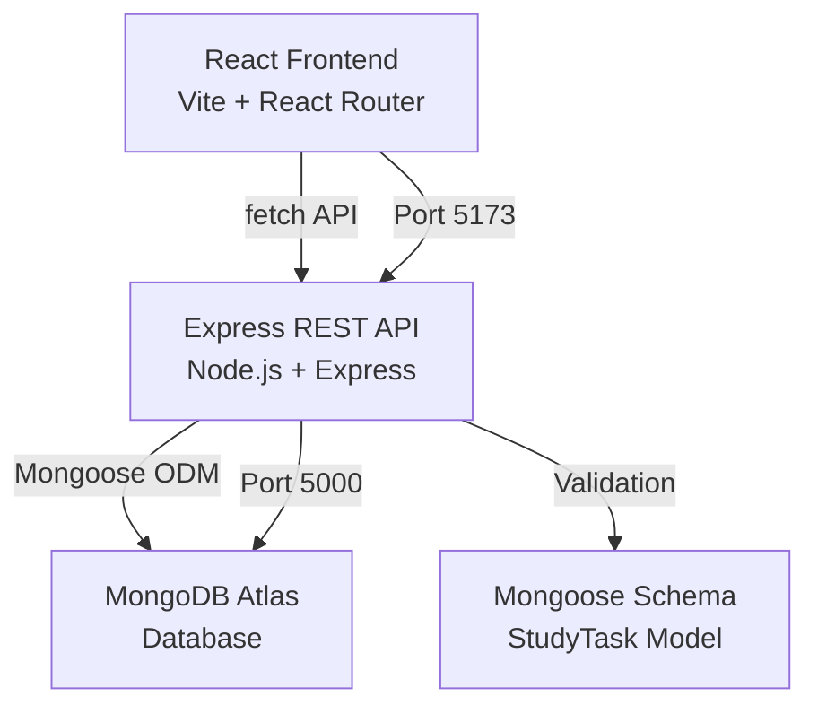

# StudyFlow 📘

**Student Study Planner** — A full-stack MERN application that helps students organize their study workload with subjects, tasks, deadlines, priorities, estimated study durations, completion tracking, filters, and progress analytics.

## Screenshots

> Screenshots can be added after running the application locally.

## Features

- **Task Management** — Create, read, update, and delete study tasks
- **Smart Filtering** — Filter tasks by status, priority, subject, and sort by deadline/newest/priority
- **Completion Tracking** — Mark tasks complete/incomplete with timestamp tracking
- **Dashboard** — Overview with stat cards, today's study plan, and upcoming tasks
- **Progress Analytics** — Completion percentage, study time tracking, and per-subject breakdown
- **Validation** — Client-side and server-side input validation
- **Responsive Design** — Works on mobile phones through desktops
- **Error Handling** — Graceful loading, error, and empty states throughout
- **Priority System** — Low, Medium, High priority levels with visual indicators
- **Due Date Tracking** — Overdue detection and days-until-due display

## Tech Stack

| Layer     | Technology                     |
|-----------|--------------------------------|
| Frontend  | React, Vite, React Router, CSS |
| Backend   | Node.js, Express.js            |
| Database  | MongoDB with Mongoose ODM      |
| Testing   | Jest, Supertest, mongodb-memory-server |
| Dev Tools | Nodemon, Git                   |

## Architecture



## Project Structure

```
student-study-planner/
│
├── backend/
│   ├── config/
│   │   └── db.js                 # MongoDB connection
│   ├── controllers/
│   │   └── taskController.js     # Request handlers
│   ├── middleware/
│   │   └── errorHandler.js       # Centralized error handling
│   ├── models/
│   │   └── StudyTask.js          # Mongoose schema/model
│   ├── routes/
│   │   └── taskRoutes.js         # API route definitions
│   ├── tests/
│   │   └── tasks.test.js         # API integration tests
│   ├── .env.example
│   ├── server.js                 # Express server entry
│   └── package.json
│
├── frontend/
│   ├── public/
│   │   └── favicon.svg
│   ├── src/
│   │   ├── components/
│   │   │   ├── Navbar.jsx        # Top navigation
│   │   │   ├── TaskCard.jsx      # Task display card
│   │   │   ├── TaskForm.jsx      # Create/edit form
│   │   │   ├── FilterBar.jsx     # Filter controls
│   │   │   ├── StatCard.jsx      # Dashboard stat card
│   │   │   ├── EmptyState.jsx    # Empty state display
│   │   │   └── LoadingState.jsx  # Loading spinner
│   │   ├── pages/
│   │   │   ├── Dashboard.jsx     # Home dashboard
│   │   │   ├── Tasks.jsx         # Task list with filters
│   │   │   ├── AddTask.jsx       # Create task form
│   │   │   ├── EditTask.jsx      # Edit task form
│   │   │   ├── Progress.jsx      # Progress analytics
│   │   │   └── NotFound.jsx      # 404 page
│   │   ├── services/
│   │   │   └── api.js            # Centralized API client
│   │   ├── utils/
│   │   │   └── helpers.js        # Utility functions
│   │   ├── App.jsx               # Root component + routes
│   │   ├── main.jsx              # Entry point
│   │   └── index.css             # Design system + styles
│   ├── .env.example
│   ├── index.html
│   ├── vite.config.js
│   └── package.json
│
├── .gitignore
└── README.md
```

## Requirements

- **Node.js** >= 18.x
- **npm** >= 9.x
- **MongoDB Atlas** account (or local MongoDB)

## Installation

### 1. Clone the Repository

```bash
git clone https://github.com/<your-username>/student-study-planner.git
cd student-study-planner
```

### 2. Backend Setup

```bash
cd backend
npm install
```

Create a `.env` file from the example:

```bash
cp .env.example .env
```

Edit `.env` with your MongoDB connection string:

```env
MONGO_URI=mongodb+srv://<username>:<password>@cluster.mongodb.net/studyflow?retryWrites=true&w=majority
PORT=5000
NODE_ENV=development
```

### 3. Frontend Setup

```bash
cd ../frontend
npm install
```

Create a `.env` file:

```bash
cp .env.example .env
```

The default values should work for local development:

```env
VITE_API_URL=http://localhost:5000
```

### 4. MongoDB Atlas Setup

1. Create a free account at [MongoDB Atlas](https://www.mongodb.com/cloud/atlas)
2. Create a new cluster
3. Create a database user with read/write access
4. Whitelist your IP address (or use `0.0.0.0/0` for development)
5. Get your connection string and add it to `backend/.env`

## Environment Variables

### Backend (`backend/.env`)

| Variable    | Description                    | Default       |
|-------------|--------------------------------|---------------|
| `MONGO_URI` | MongoDB connection string      | *(required)*  |
| `PORT`      | Server port                    | `5000`        |
| `NODE_ENV`  | Environment mode               | `development` |
| `CORS_ORIGIN` | Allowed CORS origins (comma-separated) | `http://localhost:5173,http://localhost:4173` |

### Frontend (`frontend/.env`)

| Variable       | Description         | Default                  |
|----------------|---------------------|--------------------------|
| `VITE_API_URL` | Backend API base URL | `http://localhost:5000`  |

## Running Locally

### Start the Backend

```bash
cd backend
npm run dev
```

The API will be available at `http://localhost:5000`.

### Start the Frontend

In a separate terminal:

```bash
cd frontend
npm run dev
```

The app will be available at `http://localhost:5173`.

## API Endpoints

| Method | Endpoint                 | Purpose           |
|--------|--------------------------|-------------------|
| POST   | `/api/tasks`             | Create a task     |
| GET    | `/api/tasks`             | List/filter tasks |
| GET    | `/api/tasks/:id`         | Get single task   |
| PUT    | `/api/tasks/:id`         | Update a task     |
| PUT    | `/api/tasks/:id/complete`| Toggle completion |
| DELETE | `/api/tasks/:id`         | Delete a task     |
| GET    | `/api/health`            | Health check      |

### Query Parameters for `GET /api/tasks`

| Parameter   | Values                           | Example                         |
|-------------|----------------------------------|---------------------------------|
| `priority`  | `Low`, `Medium`, `High`          | `?priority=High`                |
| `subject`   | Any subject name                 | `?subject=DSA`                  |
| `completed` | `true`, `false`                  | `?completed=false`              |
| `sort`      | `deadline`, `newest`, `priority` | `?sort=newest`                  |

Filters can be combined: `?subject=DSA&priority=High&completed=false`

## Example API Requests

### Create a Task

```bash
curl -X POST http://localhost:5000/api/tasks \
  -H "Content-Type: application/json" \
  -d '{
    "title": "Binary Trees Revision",
    "subject": "DSA",
    "priority": "High",
    "dueDate": "2026-10-15",
    "estimatedMinutes": 120,
    "description": "Revise traversals and solve five practice problems."
  }'
```

### Get All Tasks

```bash
curl http://localhost:5000/api/tasks
```

### Filter Tasks

```bash
curl "http://localhost:5000/api/tasks?priority=High&completed=false"
```

### Mark Task Complete

```bash
curl -X PUT http://localhost:5000/api/tasks/<task_id>/complete
```

### Delete a Task

```bash
curl -X DELETE http://localhost:5000/api/tasks/<task_id>
```

## Testing

### Run Backend Tests

```bash
cd backend
npm test
```

Tests use `mongodb-memory-server` — no external database required.

### Build Frontend

```bash
cd frontend
npm run build
```

## Deployment Notes

- Set `NODE_ENV=production` for the backend
- Build the frontend with `npm run build` and serve the `dist/` folder
- Update `CORS_ORIGIN` in backend `.env` with your production frontend URL
- Update `VITE_API_URL` in frontend `.env` with your production API URL
- Ensure MongoDB Atlas network access is configured for your server IP

## Known Limitations

- No user authentication (single-user application)
- No real-time updates (requires page interaction to refresh data)
- No data export/import functionality
- No recurring task support
- No dark mode (design system supports it via CSS variables)

## Future Improvements

- User authentication with JWT
- Dark mode toggle
- Calendar view for tasks
- Study session timer
- Data export (CSV/JSON)
- Push notification reminders
- Recurring tasks
- Drag-and-drop task reordering
- Subject color customization
- Study analytics over time (weekly/monthly charts)

## License

MIT
